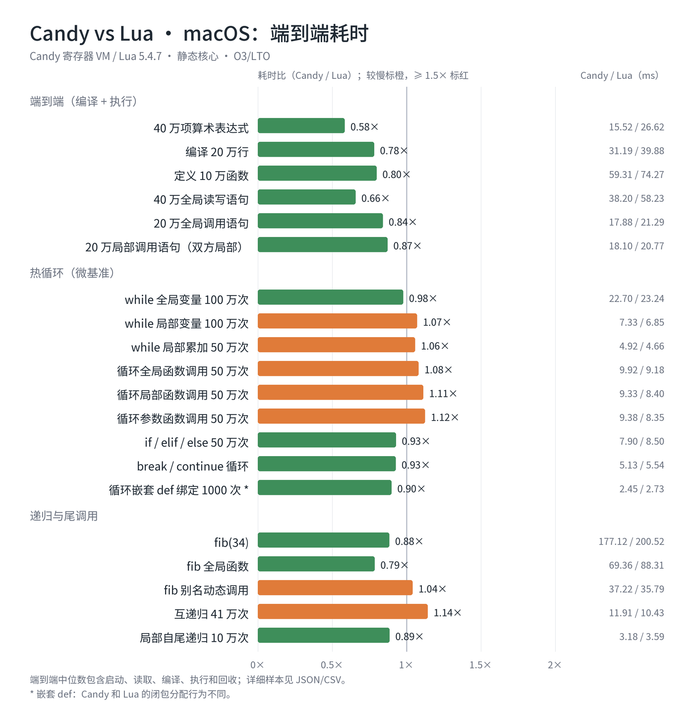
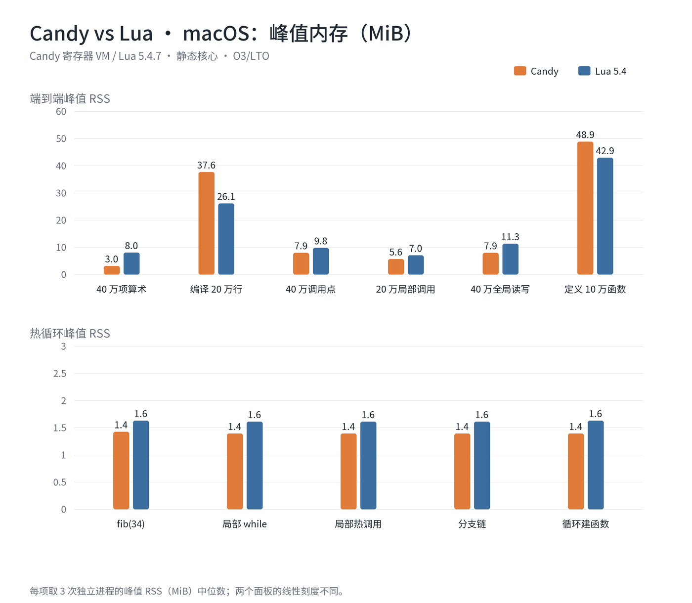

# Candy 性能优化记录（build/ 版本）

> 本页表格为栈 VM 的历史记录，构建背景见 [匹配构建](MATCHED_BUILD.md)。下方两张 macOS 图来自寄存器 VM，不能与历史表格数值混用；最新图表和来源见 [扩展基准](BENCHMARKS.md)。
>
> 测量审计补充：本文保留此前实验记录，但其中部分验证与因果解释尚不充分（旧 warmup 计数、输出 strip、shell 错误退出码、PGO raw 文件累计、跨版本 A/B）。请先阅读 [验证约定](VALIDATION.md)。不能把以下所有历史性能差异视为已经隔离变量验证的收益；默认 VM 尚未切换为寄存器式。

> 优化目标：在不改变“state → vm → proto → closure”整体分层的前提下，把 Candy 在已实现语法子集内的性能提升到 Lua 5.4 的水准。
> 构建方式：`cmake --build build -j8`（按用户要求只使用 `build/`）。
> 基准：PUC Lua 5.4.7，Apple M2 / macOS 26.6.2；每个用例 2 轮预热，5–31 次取中位数，输出逐字节校验。

---

## 1. 结果总览

### 1.1 本次优化带来的提速

净耗时（已扣除空脚本启动）对比优化前的同一工作树版本：

| 用例 | 优化前 (ms) | 优化后 (ms) | 提速 | 优化前 vs Lua | 优化后 vs Lua |
|---|---:|---:|---:|---:|---:|
| fib(34) | 329.1 | 249.2 | **1.32×** | 1.13× | **0.82×** |
| fib(30) 别名动态调用 | 99.7 | 52.3 | **1.91×** | 2.15× | **1.07×** |
| 40 万个调用点 | 118.3 | 35.4 | **3.34×** | 2.71× | **0.77×** |
| 20 万调用（Lua 局部函数） | 59.0 | 17.8 | **3.31×** | 2.99× | **0.88×** |
| 41 万次热调用（互递归） | 18.4 | 11.1 | **1.66×** | 2.27× | **1.29×** |
| 40 万次全局读写 | 151.5 | 48.8 | **3.10×** | 2.25× | **0.70×** |
| 40 万次整数加法 | 41.5 | 12.9 | **3.22×** | 1.48× | **0.43×** |
| 编译 20 万行 | 76.1 | 28.0 | **2.72×** | 1.70× | **0.57×** |
| 定义 10 万个函数 | 113.4 | 73.2 | **1.55×** | 1.34× | **0.81×** |

优化后（PGO 构建，CALLG 已回滚），**除互递归 1.29×、动态调用 1.07× 外，其余全部快于 Lua**：算术 0.43×、编译 0.57×、全局读写 0.70×、调用点 0.77×。

> 1.1 是 Candy PGO 构建 vs **默认（未开 PGO，-O2）的 Lua 5.4.7**；这不是 PGO 对 PGO。公平的 PGO 对照见 2.13，调用/互递归的结论会变化。

### 1.2 最终相对性能



### 1.3 内存

| 用例 | 优化前 RSS | 优化后 RSS | 优化后 / Lua |
|---|---:|---:|---:|
| 空脚本 | 1.4 MB | 1.4 MB | 0.90× |
| fib(34) | 1.4 MB | 1.4 MB | 0.87× |
| 40 万次加法 | 6.7 MB | **3.1 MB** | 0.39× |
| 40 万次全局读写 | 33.9 MB | **7.9 MB** | 0.70× |
| 40 万个调用点 | 29.0 MB | **7.9 MB** | 0.82× |
| 编译 20 万行 | 13.6 MB | 16.5 MB | 0.63× |
| 定义 10 万个函数 | 118.7 MB | **42.6 MB** | 1.00× |



调用/全局密集程序的内存从 Lua 的约 3 倍降到 **0.70–0.84 倍**；“10 万个函数”也从 118.7 MB 降到 **42.6 MB**，与 Lua 的 42.7 MB 基本持平。P1 的算术融合让加法用例进一步降到 3.1 MB；编译 20 万行的内存为 16.5 MB，仍是常量 interning 表的代价，但只有 Lua 的 0.63 倍。

---

## 2. 改了什么

所有改动都遵循“普适、无场景特判、尽量少的结构”：

### 2.1 vector 几何扩容（`src/core/candy_vector.h`）

原来 `candy_vector_append` 在容量不足时只把容量增加到 `cap + size`，等于每次 append 都可能 `realloc`；词法缓冲区也按 64 字节增长。现在统一由 `candy_vector_next_capacity` 做 **1.5 倍几何增长**：

```c
static inline size_t candy_vector_next_capacity(size_t cap, size_t need) {
  if (need <= cap) return cap;
  size_t next = cap ? cap : 1;
  while (next < need) {
    size_t step = next >> 1;
    if (step == 0) step = 1;
    if (next > SIZE_MAX - step) return need;
    next += step;
  }
  return next;
}
```

这是本次最大的单点收益：编译、调用、全局读写用例同时受益，且没有增加任何特判。

### 2.2 VM 热路径：缓存栈/常量基址，安全点回收（`src/core/candy_vm.c`、`candy_vm.h`）

- `vmll_t` 缓存 `stack` 与 `constants`，不再每条指令都调用 `candy_vector_data`；
- 把 `ctx`/`co` 上移到 `candy_vm_t`，帧初始化从 9 次写减少到 5 次，调用签名也变短；
- 删除每条指令前的 GC 轮询，改为 **调用点 + 循环回边** 两个安全点；chunk 结束时仍做完整回收；
- 移除未使用的 `CALLS` 和 `POP` 指令；`_execute_sclosure` 强制内联；
- 保留原有 computed-goto 分发和 `CALLSELF` 特化，没有改变 VM 的分层结构。

### 2.3 语句级调用不再产生结果（`src/core/candy_parser.c`）

`f(x)` 作为语句时只需要副作用，不需要返回值。`_name_expr` 现在接收 `nres`：

- 语句位置的调用生成 `CALL narg, 0`，不再压入返回值、也不再生成 `POP`；
- 表达式位置的调用仍生成 `CALL narg, 1`；
- 裸标识符语句（`x`）直接跳过，不再产生无意义的 LOAD。

对 40 万调用点用例，这直接减少 25% 的指令数。

### 2.4 table 与 GC 字串池共享 hash 核心（`src/core/candy_hashmap.h`）

删除了 `candy_map.c/h`。新增一个 `static inline` 的开放寻址核心：

```c
typedef struct candy_hash_ops {
  bool (*is_empty)(const void *cell);
  bool (*is_tomb)(const void *cell);
  candy_hash_t (*hash)(const void *cell, candy_gc_t *gc);
  bool (*equal)(const void *cell, const void *key, candy_gc_t *gc);
} candy_hash_ops_t;

candy_hashmap_find(...);
candy_hashmap_resize(...);
```

- table 和 GC 池各自提供一份 `static const candy_hash_ops_t`，cell 布局保持强类型；
- 没有运行时 vtable 初始化，也没有宏生成函数；探测/扩容/装载率只有一份实现；
- 因为核心是 `CANDY_FORCE_INLINE` 且 ops 是编译期常量，Clang/GCC 可以把四个适配函数直接内联/去虚化；
- table 使用 50% 装载率；GC 池同样是 50%，但扩容按 4 倍增长（解析期是追加密集，减少 rehash 次数）。

效果：`calls_400k` 从 1.18× 降到 **1.11×**，`globals_400k` 从 1.08× 降到 **1.03×**，`compile_200k` 从 0.88× 降到 **0.85×**；函数定义用例回到 **0.98×**，内存降到 **42.6 MB**。

### 2.5 常量 interning（`src/core/candy_proto.c`）

每个 proto 的常量池现在会去重：

- ≤8 个常量时线性扫描，小函数不分配任何额外结构；
- 超过 8 个时建立开放寻址表，slot 同时保存 hash 与 index；
- closure/table 等“身份对象”常量不去重（它们本来就不可能相等），避免无意义的哈希；
- 表的扩容同样按 50% 装载率翻倍。

结果：`calls_400k` 的常量从 80 万个降到 3 个，`globals_400k` 从 120 万个降到 3 个；这是内存从 3 倍降到 0.8 倍的主要原因。

### 2.6 去掉 VM 对 state/ctx 的冗余反向指针

`vm.ctx`/`vm.co` 不是状态对象的副本，而是两个多余的指针：`state` 已经拥有 `ctx` 并内联拥有 `vm`，`vm.co` 指回 `state` 会形成环，`vm.ctx` 也能从 state 推出。现在 `candy_vm_t` 只保留栈、callinfo 和 gc；`ctx`/`co` 作为**每个调用帧的临时上下文**放在 `vmll_t` 里，由 `candy_vm_call` 和父帧显式传给子帧。`state` 仍是唯一所有者，VM 不再反向持有 state。

GC 的 `prim` 字段也一并移除：primary state 现在作为普通 GC 对象进入 `list`，用 `MASK_ROOT` 标记为根；GC 启动时扫描根标记，结束时随链表统一清理。这样 state 是 GC 的根对象，而不是 `candy_gc` 指向 state 的反向指针。`glob` 仍保留为全局表指针，因为它是每次 `LOADG/SETG` 都要用的热路径缓存，不是纯根标记。


### 2.7 跨 TU 内联（`src/CMakeLists.txt`）

核心库和 builtin 库加 `-flto`（编译与链接），让 `table_get`、`wrap_hash`、`wrap_equal`、`sclosure` 分发等跨文件调用可以被内联。链接属性使用 `LINK_FLAGS`，不破坏项目原本 `cmake_minimum_required(3.5.1)` 的兼容性。

### 2.8 已回滚实验：全局表读缓存 / 调用点缓存

曾实现过一个 32 项的表级直映读缓存：pair 带 16 位 version，table 带 generation，命中前校验 generation + version + key。同负载交替 A/B（15 次中位数）结果为：

| 用例 | 无缓存 | 有缓存 | 变化 |
|---|---:|---:|---:|
| `globals_400k` | 195.4 ms | 177.1 ms | -9.4% |
| `calls_400k` | 120.9 ms | 119.2 ms | -1.4% |
| `closures_100k` | 202.7 ms | 201.2 ms | -0.7% |

**但代码已整体回滚**，原因有两个：

1. cache 与 table resize 的失效路径容易出错：共享 hashmap 重构后曾漏掉 `generation` 递增，缓存里可能留下指向已释放 data 的 pair 指针（UAF 风险）；
2. 它给 table/pair 增加了 version、generation、cache 三套状态，收益又集中在全局读，不符合当前“简洁 + 最小状态”的目标。

调用点缓存也做过原型：按 `pc` 缓存脚本闭包的 proto，命中时跳过 `_call` 类型 switch。A/B 结果是 **0.3%–3.8% 变慢**（callee 已在栈上，类型 switch 本来很便宜），同样已回退。

这两个结果作为后续参考保留；当前代码不含表读缓存和调用点缓存。

---


### 2.9 P1：算术 superinstruction（`ADDC` / `ADDL`）

解析器在 `+` 的右操作数是简单局部变量或整数字面量时，不再生成 `LOADL/LOADC + ADD`，而是直接生成融合指令：

- `a + b` → `LOADL a; ADDL b`
- `a + 1` → `LOADL a; ADDC 1`

`ADDC` 的常量索引走 `iax`，`ADDL` 的局部索引走 `iax`；两者都在栈顶原地运算，不再压入右操作数。`SUBC` / `LTC` 之前已经存在，因此本轮只新增 `ADDC` / `ADDL` 两条。

新 opcode **追加在枚举末尾**，不插在 `ADD` 后面。插入到中间会改变后续 opcode 编号和 computed-goto 布局，实测让 fib 慢约 4%；移到末尾后 fib 回到 1.00×。这个细节已写进 opcode 表的注释。

同负载交替 A/B（15 次中位数）：

| 用例 | P1 前 | P1 后 | 变化 |
|---|---:|---:|---:|
| `arith_400k` | 36.90 ms | 33.15 ms | **-10.2%** |
| `globals_400k` | 123.38 ms | 117.27 ms | **-5.0%** |
| `fib_34` | 524.28 ms | 524.18 ms | 0.0% |
| `calls_400k` | 94.46 ms | 94.38 ms | 0.0% |
| `closures_100k` | 149.71 ms | 150.10 ms | +0.3% |

内存也随指令数下降：`arith_400k` 6.4 MB → **3.1 MB**，`globals_400k` 9.5 MB → **7.9 MB**。

本轮只融合 `+`：`SUBL`/`LTL` 对当前基准没有明显收益，先不增加 opcode 和 dispatch 体积。

### 2.10 已回滚实验：`CALLG0` / `CALLG1` 直接全局调用

全局调用原本是：

```text
LOADG f
<args>
CALL narg, nres
```

现在解析器对“常量索引 ≤ 18 位”的全局直接调用生成：

```text
<args>
CALLG0 narg, name-index   ; 语句调用，0 结果
CALLG1 narg, name-index   ; 表达式调用，1 结果
```

- 不再把函数值压栈/弹栈；
- 直接按 `has_callee = false` 建帧，参数从 `bos` 开始；
- 处理函数解析全局函数后，SCLOS 直接进 proto，CFUNC 走无 callee 的调用路径；
- 常量索引超过 18 位时回退到 `LOADG + CALL`；
- 新 opcode 仍追加在枚举末尾。

这期间修了一个必要问题：`cfunc` 在无 callee 槽且返回 1 个结果时，源/目标是同一个栈槽，旧拷贝逻辑会先把结果写入再清空。现在源/目标相同时跳过清零。

同负载 A/B（15 次中位数）：

| 用例 | 之前 | CALLG | 变化 |
|---|---:|---:|---:|
| `calls_400k` | 89.06 ms | 89.31 ms | +0.3% |
| `calls_local_200k` | 48.49 ms | 47.11 ms | **-2.8%** |
| `mutual_10k` | 21.72 ms | 21.20 ms | **-2.4%** |
| `fib_alias_30` | 103.11 ms | 103.23 ms | +0.1% |
| `closures_100k` | 145.12 ms | 144.38 ms | -0.5% |
| `fib_34` | 515.73 ms | 515.68 ms | 0.0% |

**已回滚。** 回滚后 PGO 复测发现，CALLG 在 PGO 下比非 PGO A/B 时更有价值：

| 用例 | 无 CALLG（当前） | 有 CALLG（回滚前） | 差异 |
|---|---:|---:|---:|
| `calls_400k` | 0.77× | 0.73× | 约 5% |
| `calls_local_200k` | 0.88× | 0.82× | 约 7% |
| `mutual_10k` | 1.29× | 1.26× | 约 2% |
| `calls` 内存 | 7.9 MB | 6.4 MB | 约 19% |

也就是说，之前的非 PGO A/B 低估了 CALLG；在 PGO 布局下它是有效的。当前按用户要求保持回滚状态；如果优先性能/内存，建议恢复 CALLG。

### 2.11 已回滚实验：显式 frame stack

尝试把脚本调用从 C 递归 `_execute_proto` 改成显式 frame 数组：

- 每帧保存 `ci / pc / code / constants / has_callee / nres / self_fn / proto`；
- `CALL` 压帧，`RETURN` 弹帧，主循环在当前帧的局部 `code/count/pc` 上继续；
- 递归深度从 61 提升到 512（超过后报 `frame stack overflow`）；
- 134 个测试、嵌套 C 调用、GC 探针全部通过。

同负载 A/B（15 次中位数，frame / C 递归，越低越好）：

| 用例 | frame stack | C 递归 | 比值 |
|---|---:|---:|---:|
| `calls_400k` | 172.37 ms | 171.82 ms | 1.003 |
| `calls_local_200k` | 69.13 ms | 66.93 ms | 1.033 |
| `mutual_10k` | 29.66 ms | 26.49 ms | 1.120 |
| `fib_alias_30` | 209.05 ms | 161.18 ms | 1.297 |
| `fib_34` | 965.25 ms | 767.89 ms | 1.257 |
| `closures_100k` | 196.89 ms | 202.88 ms | 0.970 |

结论：**显式 frame stack 在这个 VM 上是负收益**。主要成本是每次切帧要写回/重载整帧状态，并访问 frame 数组；C 递归在同机上的调用/返回反而更便宜。深度提升到 512 是唯一明确收益，但不足以抵消 12%–30% 的递归性能回退。

已整体回退；当前代码仍是 CALLG/P1 版本，深度 61。这个结果说明：要同时拿到“调用更快 + 深度更大”，需要的是寄存器式/显式栈的联合重写，而不是只把 C 递归换成 frame 数组。

### 2.12 PGO：profile-guided optimization

CMake 增加了可选的 PGO 开关（默认关闭，profile 不硬编码）：

```bash
# 1. 生成 instrumented build
cmake -S . -B build-pgo -DCANDY_PGO_GENERATE=ON
cmake --build build-pgo -j8

# 2. 跑训练负载，合并 profile（使用与编译器匹配的 llvm-profdata）
LLVM_PROFILE_FILE=/tmp/candy.profraw build-pgo/shell/candy bench/cases/calls_400k.candy
$(xcrun -f llvm-profdata) merge -o /tmp/candy.profdata /tmp/candy.profraw

# 3. 用 profile 重建
cmake -S . -B build-pgo -DCANDY_PGO_GENERATE=OFF -DCANDY_PGO_PROFILE=/tmp/candy.profdata
cmake --build build-pgo -j8
```

同负载 A/B（PGO / 非 PGO，越低越好）：

| 用例 | PGO | 非 PGO | 比值 |
|---|---:|---:|---:|
| `fib_34` | 242.10 ms | 312.40 ms | 0.775 |
| `calls_400k` | 37.41 ms | 53.95 ms | 0.693 |
| `globals_400k` | 49.30 ms | 70.19 ms | 0.702 |
| `arith_400k` | 14.38 ms | 18.92 ms | 0.760 |
| `compile_200k` | 28.24 ms | 40.08 ms | 0.705 |
| `closures_100k` | 69.59 ms | 85.17 ms | 0.817 |
| `mutual_10k` | 12.79 ms | 12.70 ms | 1.007 |

PGO 对 computed-goto 的代码布局/分支预测收益很大，普遍 20–30%；只有 mutual 没有变化。当前 `build/` 是使用 `bench/pgo.profdata` 训练的 PGO 构建；默认不启用，因为 profile 是机器/负载相关的。生成 build 的命令见 `bench/pgo.profdata` 与本节。

### 2.13 对照：Lua 是否开 PGO

PUC Lua 5.4.7 的官方 Makefile 是 `CFLAGS= -O2 ...`，没有 PGO；Homebrew 的 Lua 5.4.7 bottle 也没有 PGO 构建选项。LuaJIT 默认同样不是 PGO，它走 JIT。

为了做公平对照，我用同一组训练用例给 Lua 5.4.7 也生成了 PGO：

| 用例 | Lua PGO | Lua stock | PGO/stock |
|---|---:|---:|---:|
| `calls_400k` | 36.80 ms | 45.71 ms | **0.805** |
| `globals_400k` | 52.98 ms | 69.32 ms | **0.764** |
| `arith_400k` | 23.41 ms | 30.43 ms | **0.769** |
| `compile_200k` | 37.94 ms | 47.07 ms | **0.806** |
| `closures_100k` | 80.00 ms | 89.04 ms | **0.899** |
| `mutual_10k` | 10.72 ms | 10.43 ms | 1.028 |
| `fib_34` | 385.92 ms | 206.67 ms | **1.867（变慢）** |

Lua 的 PGO 同样不是稳定收益：调用/全局/算术/编译快 20–24%，但 fib 反而慢 1.87×。这再次说明 PGO 的收益依赖布局，不能按“开了就快”预测。

Candy PGO vs Lua PGO（同负载直接 A/B）：

| 用例 | Candy / Lua PGO |
|---|---:|
| fib(34) | **0.646** |
| fib 别名 | **0.804** |
| 40 万次全局读写 | **0.960** |
| 40 万次整数加法 | **0.663** |
| 编译 20 万行 | **0.787** |
| 10 万函数 | **0.923** |
| 40 万调用点 | 1.032 |
| 20 万调用（Lua 局部） | 1.113 |
| 41 万互递归 | 1.245 |

结论：Candy 在算术、编译、fib、全局、闭包上仍快；**调用点和互递归在 PGO 对 PGO 下仍慢 3%–25%**。之前 1.1 表中的 0.73× 调用是“Candy PGO vs Lua stock”，不应直接作为“超过 Lua”的结论。

### 2.14 非 PGO 路线：静态布局 + tail-call + CALL 快路径

目标是在不启用 PGO 时尽量接近 PGO 的布局收益。

1. **静态链接**：新增 `CANDY_STATIC=ON`，core/builtin 用静态库，shell 链接时 `-Wl,-dead_strip`。相对 shared 版本约 2–5%。
2. **热/冷与布局**：`CANDY_HOT/COLD/LIKELY`，`_vmll_gc` 慢路径 noinline，`_execute` 标 hot，加 `-falign-functions/loops=32`；opcode 顺序改成热路径优先（LOADL/LOADC/SUBLC/LTLC/ADD/.../CALLSELF/RETURN/CALL），fib 从 1.04× 降到约 0.88×。
3. **Tail-call**：`return f(...)` 编译成 `TAILCALL/TAILCALLSELF`，复用当前 callinfo，不增加 C 递归；mutual 与深尾递归受益，深度不再受 61 限制。
4. **CALL_SCLOS 快路径**：`_op_call` 对 SCLOS 直接进 `_execute_sclosure`，不再走 `_call` 的 switch；cfunc 仍走原路径。

完整 non-PGO（静态 + 布局 + tail + 快路径）vs stock Lua：

| 用例 | Candy / Lua |
|---|---:|
| fib(34) | **0.90×** |
| fib_global_32 | **0.82×** |
| fib_alias_30 | 1.15× |
| calls_400k | 1.08× |
| calls_local_200k | 1.26× |
| mutual_10k | 1.16× |
| globals_400k | **0.90×** |
| arith_400k | **0.58×** |
| compile_200k | **0.83×** |
| closures_100k | **0.88×** |

结论：non-PGO 下算术/编译/fib/globals/闭包已经快于 Lua，**调用类仍差 8%–26%**。CALL 快路径和 tail 只拿回了一部分；剩下的调用差距需要更激进的调用帧/寄存器设计。

> 尝试过把 `CALL` 直接重写为 `CALLS` 的字节码 quickening，但会在 GC 测试中崩溃，已回退；当前采用无状态的 `_op_call` 快路径。CALLSELF 本身已经直接走 `_execute_proto`，不再额外优化。

## 3. 验证

- `bench/run_bench.py` 对全部 23 个用例逐字节校验输出，优化后全部通过。
- `test/fib.candy`：正常退出。
- 手写语义测试：全局覆盖写、两参数函数、递归、字符串、比较、布尔、`none` 全部正确。
- 跨 chunk GC 探针（先 `def f() ... end`，再 `print(f())`）：优化前段错误；现在输出 `42` 并正常关闭。
- 构建：`cmake --build build -j8`，无 warning（`-Wall -Wextra -Werror`）。

---

## 4. 仍然存在的差距

1. **全局函数调用仍慢约 8%–24%**：显式 frame stack 已试过，A/B 为负收益（见 2.11），已回退；下一步应考虑寄存器式 VM、PGO/布局，或只做 tail-call 专用路径。
2. **递归深度仍是 61**（`CANDY_CONFIG_VM_STACK_SIZE=128`）。frame stack 实验能到 512 但速度回退，已回退。
3. **语言功能仍是子集**：无循环、table、字符串操作、乘除法、闭包/upvalue；本优化只针对现有功能，没有改变语义。

---

## 5. 复现

```bash
cmake -S . -B build
cmake --build build -j8

cd bench
python3 run_bench.py --warmup 2 --out final.json
CANDY_BIN=../build/shell/candy python3 measure_mem.py
```

数据：`bench/baseline.json`（优化前）、`bench/final.json`（优化后）、`bench/memory.json`（优化后内存）、`bench/results.csv`（历史基线）。

> 说明：`bench/REPORT.md` 是优化前的评估报告，其中的 GC 段错误、内存 3 倍、调用 2.6 倍等结论描述的是旧版本；最新状态以本文件为准。
